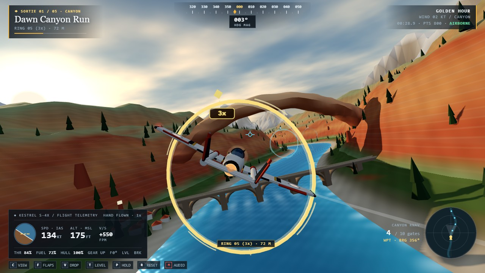
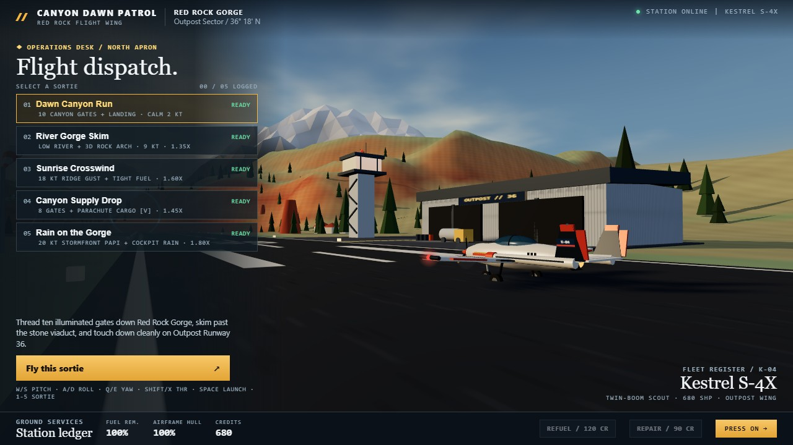
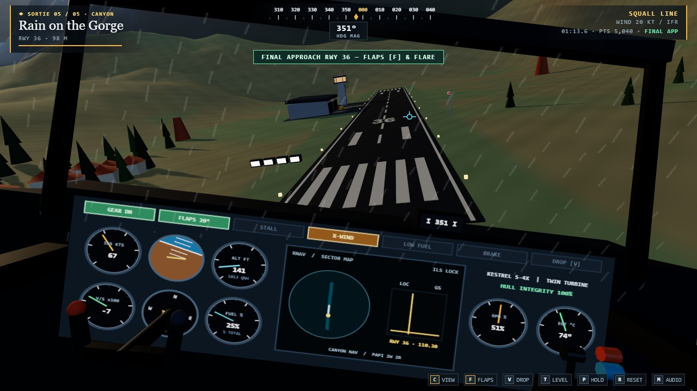
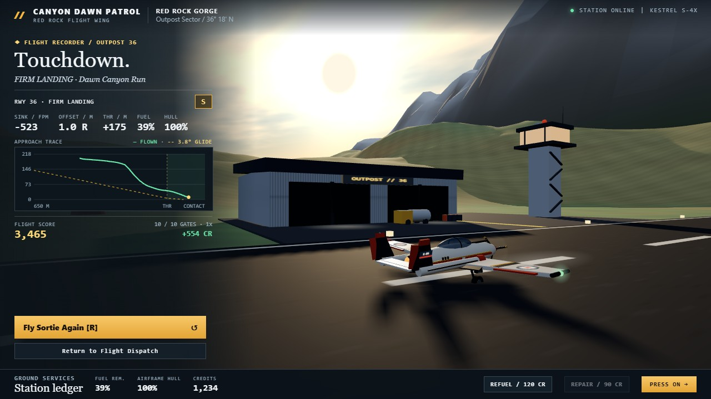

# Canyon Dawn Patrol 3D

[](https://make.fun/bounty/best-flight-game-20261126-0057?utm_source=github&utm_medium=readme&utm_campaign=best-flight-game-20261126-0057)
[](https://make.fun/bounty/best-flight-game-20261126-0057/leaderboard?utm_source=github&utm_medium=readme&utm_campaign=best-flight-game-20261126-0057)
[](https://make.fun/bounty/best-flight-game-20261126-0057?utm_source=github&utm_medium=readme&utm_campaign=best-flight-game-20261126-0057)
[](LICENSE)

Built for [make.fun](https://make.fun/r/0vh6bwht) — try the bounty yourself via my referral link.

A 3D browser flight game built on Three.js WebGL: dawn patrol through a
red-rock desert canyon at sunrise. Fly a propeller patrol plane through
glowing target rings along a winding river, past mesas and a stone arch,
then land on the desert runway. Fully offline — static files only, no
network requests. Built for the [make.fun bounty "Make the best flight
game"](https://make.fun/bounty/best-flight-game-20261126-0057).






## How to play

| Key | Action |
| --- | --- |
| W / S | Pitch down / up |
| A / D | Roll left / right |
| Q / E | Yaw |
| Shift / X | Throttle up / down |
| Space | Launch |
| C | Toggle chase / cockpit camera |
| P | Pause |
| R | Restart |
| 1–5 | Select sortie |
| V | Drop supply (sortie 4) |

## Five sorties

| Sortie | Course | Wind | Score |
| --- | --- | --- | --- |
| [1] Dawn Canyon Run | 10 gates + landing | calm 2 KT | 1.0x |
| [2] River Gorge Skim | Low river + 3D rock arch | 9 KT | 1.35x |
| [3] Sunrise Crosswind | Ridge gusts + tight fuel | 18 KT | 1.6x |
| [4] Canyon Supply Drop | 8 gates + parachute cargo | — | 1.45x |
| [5] Rain on the Gorge | Stormfront, PAPI + cockpit rain | 20 KT | 1.8x |

## Systems

- **Glowing 3D gates** in order, with **bonus rings (600)** and **arch gates (450)**
- **Bonuses**: bullseye +150, low-skim +150; touchdown bonus 900 / 600 / 350 by vertical speed
- **Ranks**: A+ / S / A / B by score and hull
- **Fuel, hull and engine temperature** gauges — run dry or overheat and the sortie ends
- **Wind indicator**: real crosswind arrow + knots; rain and IFR conditions on sortie 5
- **Station ledger**: refuel / repair for credits between sorties
- **3D cockpit** with lit instruments, yoke and throttle quadrant; chase and cockpit cameras, wingtip trails, particles, clouds, aircraft ground shadow, and a procedural WebAudio soundscape (engine rumble, wind rush, gate chimes, touchdown, fanfare)
- **Dense HUD**: speed, attitude, altitude, heading compass, throttle / fuel / hull / temperature bars, next-waypoint distance and bearing, gate progress pips, time and score

## Run it

```sh
node serve.ts   # serves the game at http://127.0.0.1:8080/
```

Or serve `game/` with any static file server. The game runs fully
offline in desktop Chrome — no network requests. `main.ts` (Node 22)
emits the deterministic build dossier.

## Credits

Built with Google Antigravity (Gemini 4 Hydrogen XHigh),
verified and submitted by [ardimakefun](https://github.com/ardimakefun).
Licensed MIT.
