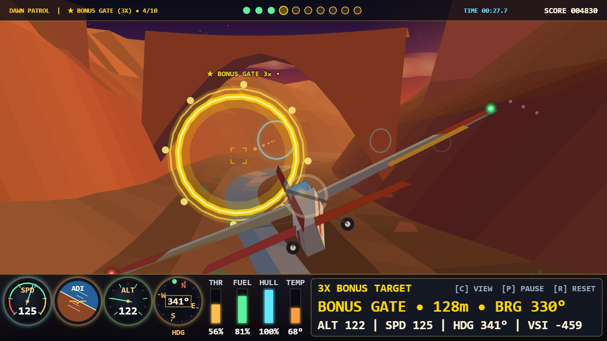
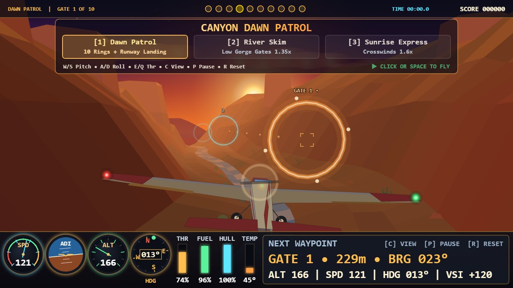
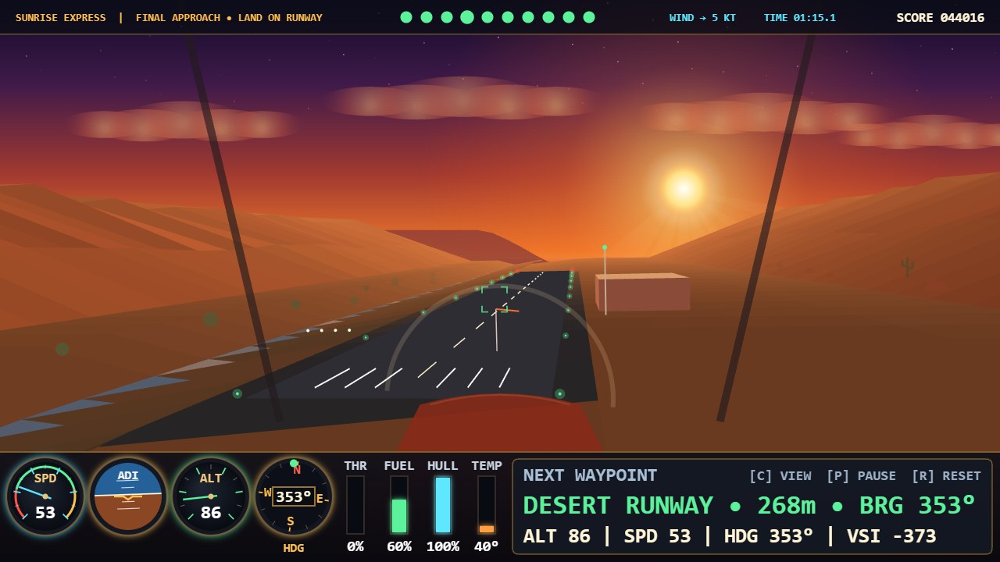
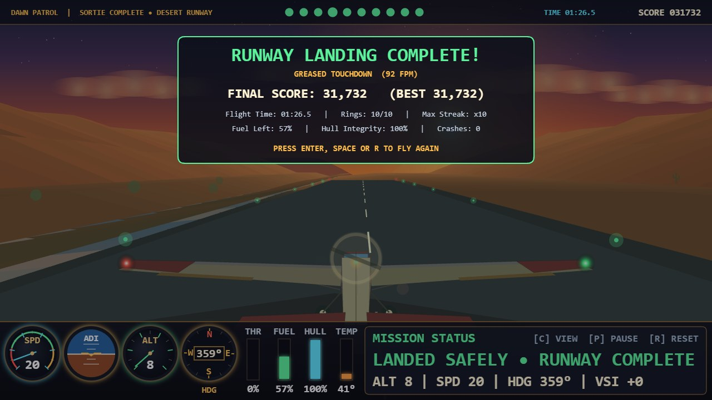

# Canyon Dawn Patrol

[](https://make.fun/bounty/best-flight-game-20261126-0057)
[](LICENSE)

A low-poly flight game set in a red-rock canyon at sunrise. Fly the dawn
patrol through 10 canyon rings — including one gold 3x bonus gate — then
land on the desert runway. Built for the [make.fun bounty "Make the best
flight game"](https://make.fun/bounty/best-flight-game-20261126-0057).






## How to play

| Key | Action |
| --- | --- |
| W / S | Pitch down / up |
| A / D | Roll left / right |
| E / Q | Throttle up / down |
| C | Toggle chase / cockpit view |
| P | Pause |
| R | Restart |
| Enter / Space | Fly again after landing |

## Three modes

| Mode | Course | Crosswind | Score |
| --- | --- | --- | --- |
| [1] Dawn Patrol | 10 canyon rings + runway landing | none | 1.0x |
| [2] River Skim | Low-altitude gorge gates | 1.2 m/s | 1.35x |
| [3] Sunrise Express | Crosswinds + fuel discipline | 2.8 m/s | 1.6x |

## Systems

- **10 canyon rings** in order, with a gold **bonus gate (3x)** on gate 4
- **Streaks**: consecutive gates add +15% each; a bullseye (dead centre) is worth 1,400 points and refunds 2.5% fuel
- **Fuel, hull and engine temperature** gauges — run dry or overheat and the sortie ends
- **Wind indicator**: shows the real crosswind (arrow + knots) in River Skim and Sunrise Express
- **Landing scoring**: touchdown vertical speed is judged — a greased landing under 150 FPM scores best
- **Chase and cockpit cameras**, wingtip trails, particles, clouds, aircraft ground shadow, and a procedural WebAudio soundscape (engine rumble, wind rush, gate chimes, touchdown, fanfare)
- **Dense HUD**: speed, attitude, altitude, heading compass, throttle / fuel / hull / temperature bars, next-waypoint distance and bearing, gate progress dots, time and score

## Run it

```sh
node serve.ts   # serves the game at http://127.0.0.1:8080/
```

Or serve `game/` with any static file server. The game runs fully
offline in desktop Chrome — no network requests. `main.ts` (Node 22)
emits the deterministic build dossier.

## Credits

Built with Google Antigravity (Gemini 4 Hydrogen + Claude Sonnet 4.6),
verified and submitted by [ardimakefun](https://github.com/ardimakefun).
Licensed MIT.
